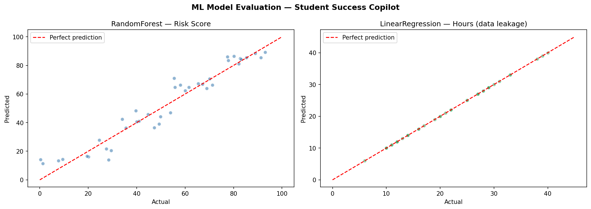

# Student Success Copilot

A hybrid AI system that takes a student's workload, deadlines, available study time, confidence, stress and sleep, and returns a risk level, a recommended number of study hours, a weekly study plan and a short explanation of the result.

Built as coursework for Fundamentals of AI at Westminster International University in Tashkent.

## How it works

The system combines four AI techniques, each handling a different part of the problem:

| Component | Technique | Role |
|---|---|---|
| `ml/` | RandomForest (regression + classification), Linear Regression | Predicts a 0-100 risk score, a risk label and recommended study hours |
| `rules/` | Rule engine with forward and backward chaining | Explains the risk level and asks a follow-up question when input is missing or inconsistent |
| `planner/` | Greedy search and A* search | Builds a weekly study schedule that puts the nearest deadlines first |
| `fuzzy/` | Fuzzy logic controller | Sets study intensity (light / moderate / intensive) from stress, workload and confidence |

`ui/app.py` runs the command-line interface. `student_success_copilot.ipynb` walks through each component with outputs and charts.

## Model evaluation



- **Risk score (RandomForest):** R² ≈ 0.93, MAE ≈ 5-6 points on a 0-100 scale.
- **Recommended hours (Linear Regression):** R² = 1.0. This is data leakage: `hours_needed` is both an input feature and the target, so the score is not meaningful.

## Limitations

- The dataset is synthetic (200 rows). Risk labels were generated from a formula, so high accuracy reflects that formula rather than real student behaviour.
- No cross-validation; RandomForest may overfit on a dataset this small.
- Gender is encoded as a single number (0 / 0.5 / 1), which is a simplification.

## Run locally

```bash
pip install -r requirements.txt
python main.py
```

Choose option 2 or 3 in the menu to see a demo student without typing any input. To retrain the models, run `python ml/ml_training.py`.
